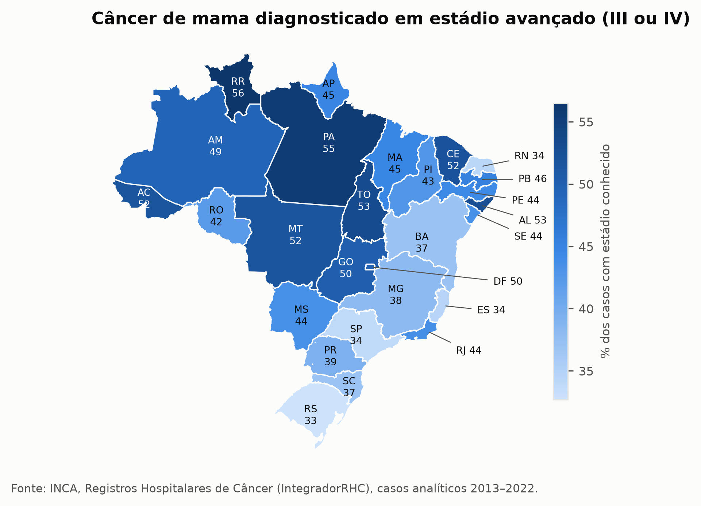
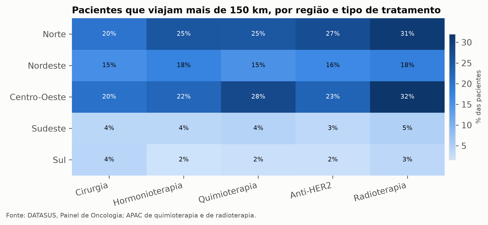

<div align="center">

# Câncer de mama no Brasil

### O que os dados públicos dizem sobre o diagnóstico, tratamento e acesso ao cuidado nas cinco regiões do país

[](https://thallescansi.github.io/cancer-mama-brasil/)
[](https://github.com/ThallesCansi/cancer-mama-brasil/actions/workflows/testes.yml)
[](pyproject.toml)
[](LICENSE)
[](https://creativecommons.org/licenses/by/4.0/deed.pt_BR)

**[Acesse o site com todos os cadernos →](https://thallescansi.github.io/cancer-mama-brasil/)**

</div>

---

Este repositório reúne a análise de dados públicos do Trabalho de Conclusão de Curso *"Investigação de assinaturas de vesículas extracelulares associadas à modulação fenotípica de células mamárias no contexto do câncer de mama"* (Ilum Escola de Ciência, CNPEM). Este projeto possui como principais autores Pedro Henrique Medeiros Bramante e Joana de Medeiros Oliveira Hulse Molinete. Ele atende ao quarto objetivo específico do projeto: entender os desafios de acesso ao diagnóstico e ao tratamento do câncer de mama no Sistema Único de Saúde, comparando as regiões Norte, Nordeste, Centro-Oeste, Sudeste e Sul.

Tudo é feito com bases oficiais e abertas do INCA e do DATASUS, baixadas e processadas por código reprodutível. Os resultados são apresentados em 13 cadernos Jupyter escritos para serem lidos por qualquer pessoa, com cada passo explicado.

<table>
<tr>
<td width="50%"></td>
<td width="50%"></td>
</tr>
<tr>
<td align="center"><sub>Diagnóstico em estádio avançado (III ou IV), por estado</sub></td>
<td align="center"><sub>Pacientes que viajam mais de 150 km, por região e tratamento</sub></td>
</tr>
</table>

## Principais resultados

| | Norte | Nordeste | Centro-Oeste | Sudeste | Sul |
|---|:-:|:-:|:-:|:-:|:-:|
| Câncer diagnosticado em estádio III ou IV | **51%** | 43% | 48% | 36% | 36% |
| Provável câncer triplo-negativo | **31%** | 24% | 22% | 21% | 17% |
| Tratamento iniciado após 60 dias do diagnóstico (SUS) | **61%** | 56% | 57% | 60% | 50% |
| Espera mediana até a radioterapia | 294 dias | 276 dias | **309 dias** | 232 dias | 193 dias |
| População em município sem tomógrafo do SUS | 35% | **45%** | 19% | 16% | 25% |
| Pacientes que viajam mais de 150 km para radioterapia | 31% | 18% | **32%** | 5% | 3% |
| Variação da mortalidade padronizada, 2013 a 2024 | **+29%** | +19% | +4% | +5% | +5% |

Mulheres com menos de 50 anos, mulheres pretas e pardas e mulheres com menor escolaridade chegam com a doença mais avançada em todas as regiões. Só metade dos mamógrafos e tomógrafos do país está disponível ao SUS, e os hospitais oncológicos se concentram no Sul, no Sudeste e nas capitais. O caderno de síntese traz cada número com sua fonte e as ressalvas necessárias.

## Os cadernos

| | Caderno | Pergunta |
|:-:|---|---|
| 00 | [Guia do projeto](notebooks/00_guia_do_projeto.ipynb) | Como o trabalho está organizado e o vocabulário usado |
| 01 | [Fontes e qualidade dos dados](notebooks/01_fontes_e_qualidade_dos_dados.ipynb) | De onde vêm os dados e o quanto podemos confiar neles |
| 02 | [Perfil das pacientes](notebooks/02_perfil_das_pacientes.ipynb) | Idade, raça/cor, escolaridade, estado conjugal e migração |
| 03 | [Rastreamento e diagnóstico](notebooks/03_rastreamento_e_diagnostico.ipynb) | Mamografias do SUS, BI-RADS, espera pelo laudo e biópsias |
| 04 | [Estádio e tipo histológico](notebooks/04_estadio_e_tipo_histologico.ipynb) | Em que fase o câncer é descoberto, e para quem |
| 05 | [Subtipos moleculares](notebooks/05_subtipos_moleculares.ipynb) | Luminal, HER2 positivo e triplo-negativo, e como estimá-los |
| 06 | [Tempo até o tratamento](notebooks/06_tempo_ate_o_tratamento.ipynb) | A espera até o primeiro tratamento e até a radioterapia |
| 07 | [Sazonalidade dos diagnósticos](notebooks/07_sazonalidade_dos_diagnosticos.ipynb) | Há meses com mais diagnósticos? Outubro Rosa e pandemia |
| 08 | [Rede pública, filantrópica e privada](notebooks/08_rede_publica_filantropica_e_privada.ipynb) | Onde as mulheres são tratadas |
| 09 | [Equipamentos e serviços](notebooks/09_equipamentos_e_servicos.ipynb) | Mamógrafos, tomógrafos e hospitais oncológicos no território |
| 10 | [Deslocamento para o tratamento](notebooks/10_deslocamento_para_o_tratamento.ipynb) | Quanto se viaja para cada etapa do cuidado |
| 11 | [Mortalidade](notebooks/11_mortalidade.ipynb) | Óbitos e taxas padronizadas por região e idade |
| 12 | [Síntese para o TCC](notebooks/12_sintese_para_o_tcc.ipynb) | Resultados, métodos e limitações para o texto |

## Fontes de dados

| Fonte | O que traz | Período |
|---|---|---|
| [Registros Hospitalares de Câncer](https://irhc.inca.gov.br/RHCNet/) (INCA) | Perfil das pacientes, estádio, tipo histológico, datas de consulta, diagnóstico e tratamento | 2013 a 2022 |
| [Painel de Oncologia](http://tabnet.datasus.gov.br/cgi/painel_onco/doc/painel_oncologia.pdf) (DATASUS) | Diagnósticos no SUS e tempo até o primeiro tratamento | 2013 a 2024 |
| SISCAN (DATASUS) | Mamografias e laudos de histopatologia de mama | 2014 a 2024 |
| APAC de quimioterapia e de radioterapia (SIA/SUS) | Tratamentos autorizados, subtipos estimados, espera e deslocamento | 2023 e 2024 |
| [CNES](https://cnes.datasus.gov.br/) (DATASUS) | Estabelecimentos, equipamentos e habilitações oncológicas | 2013 a 2025 |
| SIM (DATASUS) | Óbitos por câncer de mama | 2013 a 2024 |
| IBGE / DATASUS | Estimativas populacionais e malhas municipais | 2013 a 2025 |

Todas as bases são públicas e anonimizadas. Nenhum dado que identifique pacientes é armazenado.

## Estrutura do repositório

```
cancer-mama-brasil/
├── notebooks/            os 13 cadernos, com as saídas gravadas
├── src/mama/             pacote Python com todo o código reutilizado
│   ├── config.py         caminhos e períodos de cada fonte
│   ├── codigos.py        tabelas de códigos oficiais (IBGE, CNES, SIGTAP, SISCAN)
│   ├── harmonizacao.py   padronização de idade, região, estádio, datas e distâncias
│   ├── download/         download do INCA e do FTP do DATASUS
│   ├── fontes/           um módulo por base: lê os arquivos brutos e grava a base limpa
│   ├── analises/         um módulo por tema de análise
│   └── graficos.py       estilo único das figuras
├── scripts/              baixar_dados.py, construir_bases.py, executar_cadernos.py
├── figures/              figuras em PNG, 300 dpi
├── data/processed/       tabelas finais em CSV
├── tests/                testes das funções de padronização
├── index.qmd, _quarto.yml, site/   site publicado com Quarto
└── .github/workflows/    publicação do site e testes automáticos
```

Os dados brutos (`data/raw/`, cerca de 7 GB) e as bases intermediárias (`data/interim/`) não são versionados. Eles são recriados pelos scripts.

## Como reproduzir

É preciso Python 3.12 e, de preferência, o [uv](https://docs.astral.sh/uv/).

```bash
git clone https://github.com/ThallesCansi/cancer-mama-brasil.git
cd cancer-mama-brasil
uv venv .venv --python 3.12
uv pip install --python .venv/bin/python -e ".[dev]"

.venv/bin/python scripts/baixar_dados.py        # cerca de 7 GB, retomável
.venv/bin/python scripts/construir_bases.py     # cerca de 40 minutos
.venv/bin/python scripts/executar_cadernos.py   # regrava saídas, tabelas e figuras
.venv/bin/python -m pytest -q tests
```

Cada script aceita nomes de fontes ou números de cadernos para rodar só uma parte, por exemplo `construir_bases.py rhc painel` ou `executar_cadernos.py 03 05`. Para ver o site localmente, instale o [Quarto](https://quarto.org) e rode `quarto preview`.

## Decisões técnicas

Algumas particularidades das bases públicas foram tratadas no código e estão documentadas nos cadernos 01 e 05:

- O download "todos os estados exceto SP" do IntegradorRHC vem com cerca de metade das linhas duplicadas. Por isso é usada a base nacional com SP, com remoção de duplicatas exatas.
- Os arquivos de estabelecimentos do CNES têm 208 campos e quebram o leitor `dbfread`. A leitura cai automaticamente para o `pyogrio`.
- Nenhuma base pública traz o subtipo molecular completo, e o SISCAN registra o receptor hormonal em só cerca de 7% dos laudos. O subtipo é estimado pelo tratamento autorizado no SUS, numa coorte com pelo menos 18 meses de acompanhamento.
- O SISCAN público deixa em branco o município onde a mamografia foi feita, e os aparelhos de radioterapia ainda não aparecem nos arquivos do CNES. As análises usam as alternativas descritas nos cadernos 09 e 10.
- As distâncias são calculadas em linha reta entre os centroides dos municípios. São, portanto, um limite mínimo do deslocamento real.

## Equipe

O TCC é desenvolvido por **Joana de Medeiros Oliveira Hulse Molinete** e **Pedro Henrique Medeiros Bramante**, com orientação da **Dra. Ana Clara Bastos** (LNBio/CNPEM) e coorientação do **Prof. Dr. Emanuel Carrilho** (IQSC/USP). A análise de dados públicos foi conduzida pelos colaboradores **Thalles Cansi** e **Thomas**.

## Licença e citação

O código está sob a [licença MIT](LICENSE). Os textos dos cadernos e as figuras estão sob a licença [Creative Commons Atribuição 4.0](https://creativecommons.org/licenses/by/4.0/deed.pt_BR): podem ser reutilizados desde que a fonte seja citada. Para citar este trabalho, use o botão *Cite this repository* na lateral da página do GitHub, que lê o arquivo [`CITATION.cff`](CITATION.cff).

Os dados pertencem às suas fontes oficiais (INCA, Ministério da Saúde e IBGE). A análise dispensa apreciação por Comitê de Ética por usar apenas dados públicos e anonimizados, conforme a Resolução CNS 510/2016.
